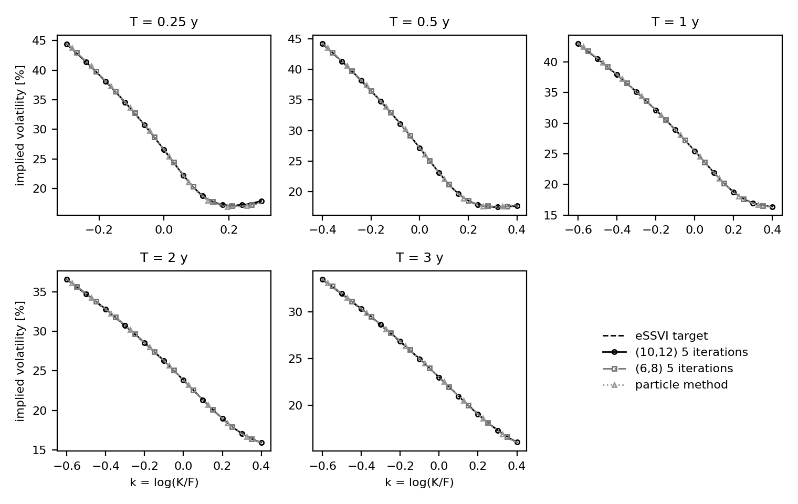

# The parametric target with the Bergomi backbone

Root mean squared error of the implied volatility against the eSSVI surface, in volatility
basis points, over the left wing, the central region and the right wing, and over the central
region of each maturity; point estimates ± two standard errors (paired delete-one jackknife
over the sets of paths).

## On 320 sets of 65,536 independent paths

| Model | left | central | right | 0.25 y | 0.5 y | 1 y | 2 y | 3 y |
|---|---|---|---|---|---|---|---|---|
| starting point L0 | 764.6 ± 2.6 | 363.0 ± 0.2 | 712.2 ± 2.3 | 418.2 ± 0.4 | 470.4 ± 0.2 | 387.2 ± 0.3 | 266.4 ± 0.2 | 204.0 ± 0.2 |
| particle method | 10.4 ± 3.8 | 5.7 ± 0.7 | 13.4 ± 0.6 | 9.4 ± 0.7 | 6.8 ± 0.8 | 3.5 ± 1.3 | 2.9 ± 1.4 | 2.4 ± 1.5 |
| (10,12) 5 iterations | 6.3 ± 3.8 | 3.7 ± 1.1 | 4.9 ± 0.6 | 2.5 ± 1.4 | 2.7 ± 1.4 | 3.8 ± 1.6 | 4.4 ± 1.3 | 4.4 ± 1.0 |
| (10,12) 12 iterations | 3.4 ± 3.8 | 2.2 ± 1.3 | 3.7 ± 0.6 | 2.5 ± 1.3 | 2.1 ± 1.5 | 2.2 ± 1.6 | 2.2 ± 1.6 | 1.9 ± 1.6 |
| (6,8) 5 iterations | 7.4 ± 3.9 | 4.9 ± 1.0 | 7.2 ± 0.8 | 7.6 ± 1.4 | 2.2 ± 1.2 | 3.7 ± 1.6 | 4.7 ± 1.2 | 4.6 ± 1.0 |
| (6,8) 12 iterations | 4.9 ± 3.5 | 3.9 ± 1.0 | 7.0 ± 0.7 | 7.7 ± 1.4 | 1.7 ± 1.2 | 2.0 ± 1.5 | 2.2 ± 1.6 | 2.3 ± 1.6 |

Monte Carlo noise alone accounts for the following part of these RMSEs:

| Model | left | central | right | 0.25 y | 0.5 y | 1 y | 2 y | 3 y |
|---|---|---|---|---|---|---|---|---|
| starting point L0 | 1.6 | 0.6 | 12.3 | 0.6 | 0.5 | 0.6 | 0.6 | 0.6 |
| particle method | 2.4 | 0.8 | 0.8 | 0.8 | 0.8 | 0.9 | 0.8 | 0.8 |
| (10,12) 5 iterations | 2.4 | 0.8 | 0.8 | 0.8 | 0.8 | 0.9 | 0.8 | 0.8 |
| (10,12) 12 iterations | 2.4 | 0.8 | 0.8 | 0.8 | 0.8 | 0.9 | 0.8 | 0.8 |
| (6,8) 5 iterations | 2.4 | 0.8 | 0.8 | 0.8 | 0.8 | 0.9 | 0.8 | 0.8 |
| (6,8) 12 iterations | 2.4 | 0.8 | 0.8 | 0.8 | 0.8 | 0.9 | 0.8 | 0.8 |

## On 20 sets of 65,536 Sobol paths

| Model | left | central | right | 0.25 y | 0.5 y | 1 y | 2 y | 3 y |
|---|---|---|---|---|---|---|---|---|
| starting point L0 | 764.8 ± 2.3 | 363.0 ± 0.2 | 706.3 ± 126.5 | 418.2 ± 0.3 | 470.3 ± 0.4 | 387.6 ± 0.4 | 266.2 ± 0.5 | 203.7 ± 0.7 |
| (10,12) 3 iterations | 28.3 ± 2.4 | 20.6 ± 1.2 | 31.8 ± 2.9 | 9.4 ± 0.5 | 16.6 ± 0.8 | 20.0 ± 0.5 | 25.2 ± 1.8 | 26.8 ± 2.9 |
| (10,12) 5 iterations | 6.3 ± 2.8 | 3.8 ± 1.1 | 4.7 ± 2.3 | 1.7 ± 0.6 | 1.9 ± 0.8 | 3.1 ± 0.7 | 5.5 ± 2.1 | 5.1 ± 2.2 |
| (10,12) 8 iterations | 2.8 ± 2.7 | 2.5 ± 1.5 | 4.1 ± 2.3 | 1.6 ± 0.6 | 1.4 ± 0.9 | 1.5 ± 0.7 | 3.6 ± 2.5 | 3.3 ± 3.3 |
| (10,12) 12 iterations | 2.9 ± 2.8 | 2.5 ± 1.5 | 4.0 ± 2.3 | 1.6 ± 0.6 | 1.4 ± 0.9 | 1.5 ± 0.8 | 3.7 ± 2.5 | 3.4 ± 3.4 |
| (6,8) 3 iterations | 30.0 ± 2.5 | 21.3 ± 1.1 | 57.2 ± 3.5 | 14.3 ± 0.5 | 16.3 ± 0.7 | 20.4 ± 0.5 | 25.0 ± 1.8 | 27.3 ± 2.8 |
| (6,8) 5 iterations | 6.7 ± 2.6 | 4.8 ± 0.9 | 6.8 ± 3.5 | 6.6 ± 0.7 | 1.6 ± 0.6 | 3.0 ± 0.7 | 5.6 ± 2.0 | 5.3 ± 2.2 |
| (6,8) 8 iterations | 3.5 ± 1.9 | 3.9 ± 1.1 | 6.9 ± 2.7 | 6.6 ± 0.6 | 1.4 ± 0.5 | 1.4 ± 0.7 | 3.6 ± 2.5 | 3.7 ± 3.3 |
| (6,8) 12 iterations | 3.6 ± 1.9 | 3.9 ± 1.1 | 6.9 ± 2.7 | 6.6 ± 0.6 | 1.4 ± 0.5 | 1.4 ± 0.7 | 3.6 ± 2.5 | 3.7 ± 3.3 |
| particle method | 9.0 ± 1.9 | 5.7 ± 0.7 | 12.8 ± 2.2 | 9.3 ± 0.4 | 6.1 ± 0.5 | 2.9 ± 0.6 | 4.1 ± 2.3 | 3.6 ± 3.1 |

Monte Carlo noise alone accounts for the following part of these RMSEs:

| Model | left | central | right | 0.25 y | 0.5 y | 1 y | 2 y | 3 y |
|---|---|---|---|---|---|---|---|---|
| starting point L0 | 1.9 | 0.7 | 48.9 | 0.3 | 0.5 | 0.5 | 1.0 | 1.0 |
| (10,12) 3 iterations | 1.9 | 1.1 | 2.9 | 0.4 | 0.6 | 0.5 | 1.3 | 1.7 |
| (10,12) 5 iterations | 1.9 | 1.1 | 2.9 | 0.4 | 0.6 | 0.5 | 1.3 | 1.7 |
| (10,12) 8 iterations | 1.9 | 1.1 | 2.9 | 0.4 | 0.6 | 0.5 | 1.3 | 1.7 |
| (10,12) 12 iterations | 1.9 | 1.1 | 2.9 | 0.4 | 0.6 | 0.5 | 1.3 | 1.7 |
| (6,8) 3 iterations | 1.9 | 1.0 | 2.8 | 0.4 | 0.6 | 0.5 | 1.3 | 1.7 |
| (6,8) 5 iterations | 1.9 | 1.0 | 2.8 | 0.4 | 0.6 | 0.5 | 1.3 | 1.7 |
| (6,8) 8 iterations | 1.9 | 1.0 | 2.8 | 0.4 | 0.6 | 0.5 | 1.3 | 1.7 |
| (6,8) 12 iterations | 1.9 | 1.0 | 2.8 | 0.4 | 0.6 | 0.5 | 1.3 | 1.7 |
| particle method | 1.9 | 1.0 | 3.1 | 0.4 | 0.6 | 0.5 | 1.3 | 1.7 |

## Smiles

Implied volatilities of the models on the 320 sets of independent paths
at the five maturities, with the eSSVI target.
