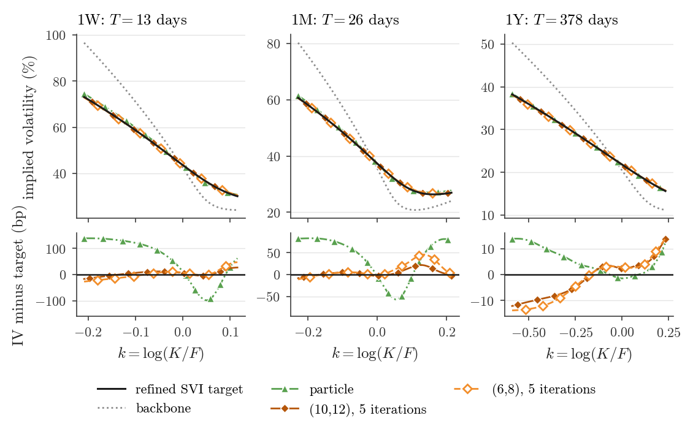
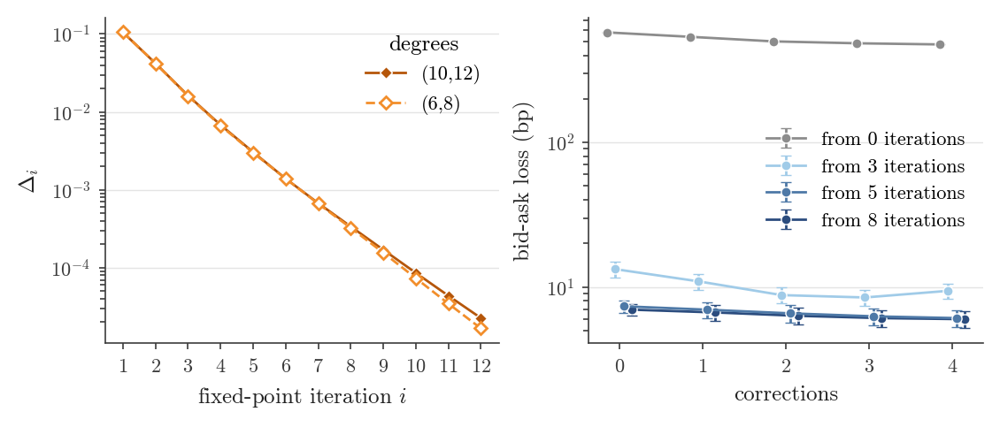
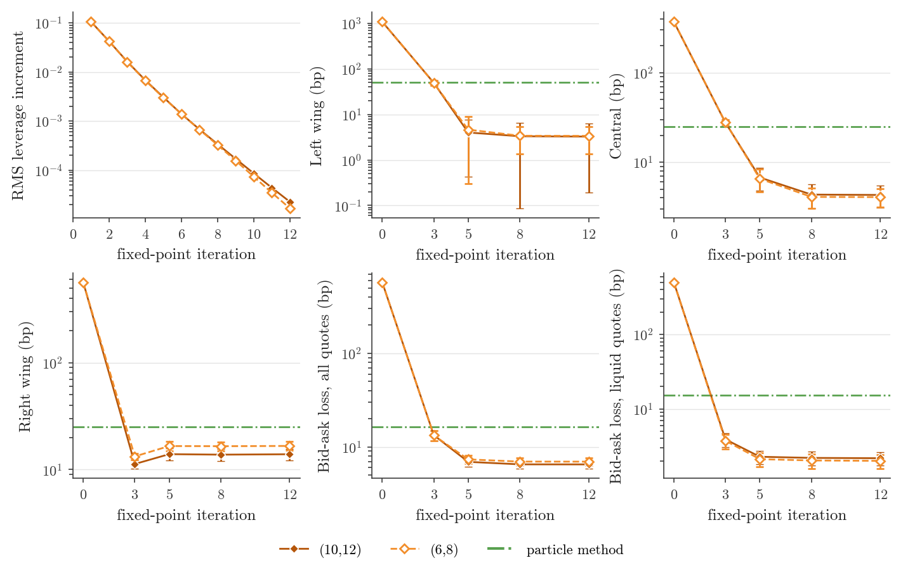
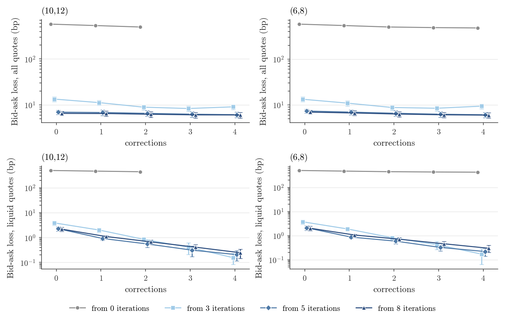
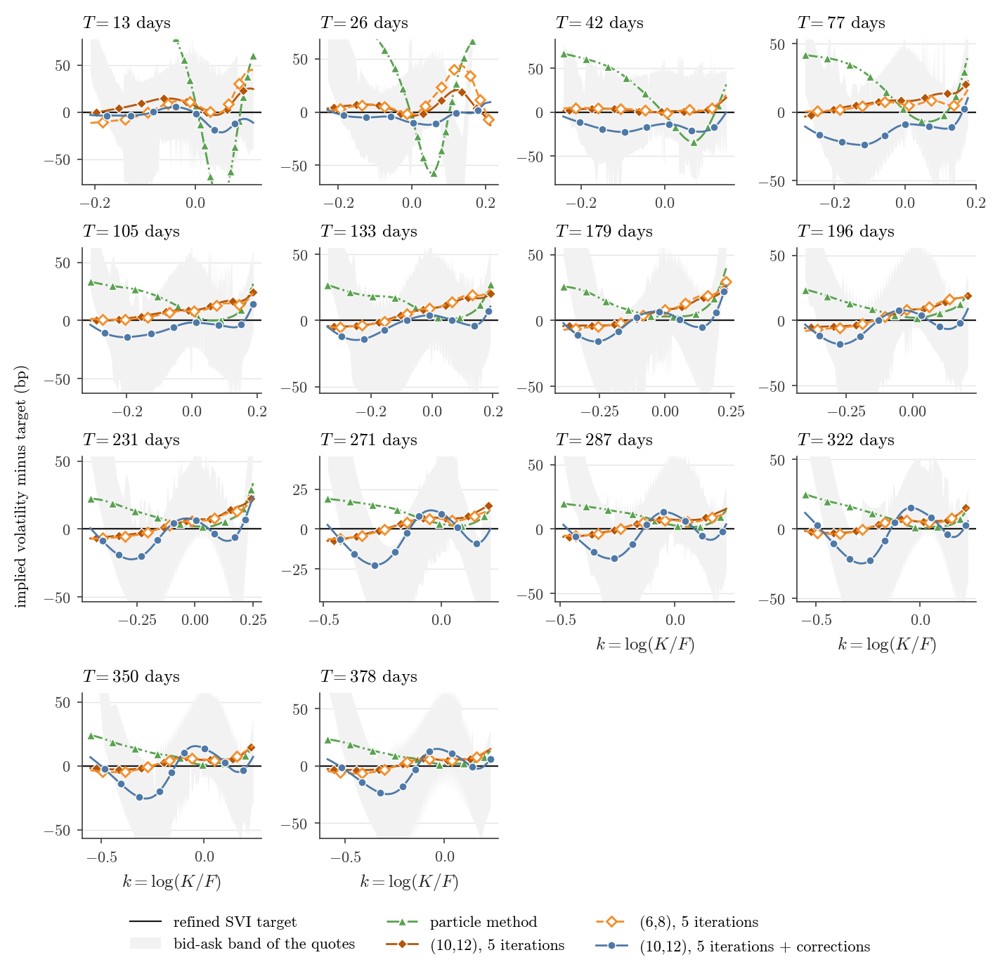
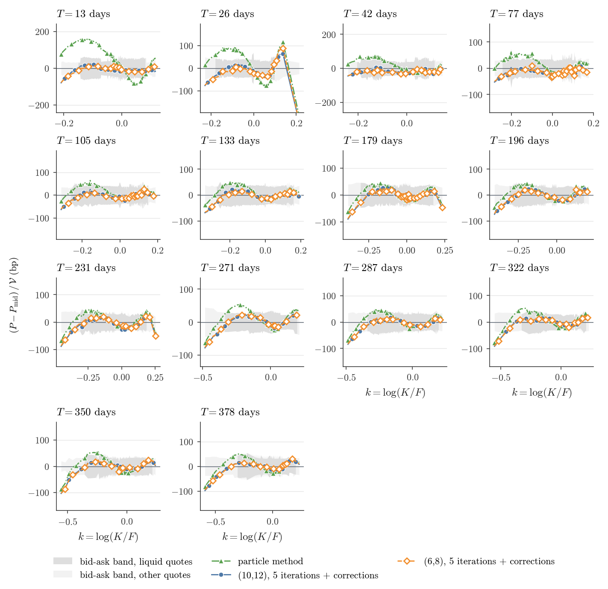

# tariffs, Heston backbone

Second day after the tariff announcement of 2 April 2025; SPX about -6%, VIX 45; the earlier day is six weeks before, since March 2025 was itself agitated. The Heston backbone is fitted to the S&P 500 index options of 2025-02-19 (kappa = 3.8738, theta = 0.0419, sigma = 1.3708, rho = -0.7223, v0 = 0.0161); the leverage factor is calibrated to the 2,577 quotes of 2025-04-04, 1,622 of them liquid, at 14 expiries from 13 to 378 days.

Contents: [the paper's tables and figures](#the-papers-tables-and-figures), [all models](#all-models), [fixed-point iteration](#fixed-point-iteration), [correction steps](#correction-steps), [smiles at every expiry](#smiles-at-every-expiry), [prices at every expiry](#prices-at-every-expiry), [Monte Carlo uncertainty](#monte-carlo-uncertainty). The numbers are in [summary.json](summary.json) and the calibrated parameters in [parameters.json](parameters.json).

## The paper's tables and figures

Both tables are computed on 320 replications of 65,536 independent pseudo-random paths. Entries are point estimates ± two standard errors (paired delete-one jackknife over the replications), in volatility basis points.

### Table 1

Root mean squared error (RMSE) of the implied volatility against the refined SVI target after 5 fixed-point iterations, with the particle method as a reference.

| Method | Left | Central | Right |
|---|---|---|---|
| Joint regression (10,12), 5 iterations | 7.08 ± 4.62 | 5.89 ± 1.01 | 14.89 ± 0.62 |
| Joint regression (6,8), 5 iterations | 8.44 ± 4.73 | 5.87 ± 0.95 | 17.66 ± 0.61 |
| Particle method | 45.99 ± 3.88 | 24.28 ± 0.81 | 26.42 ± 0.40 |

Monte Carlo noise alone accounts for the following part of these RMSEs:

| Method | Left | Central | Right |
|---|---|---|---|
| Joint regression (10,12), 5 iterations | 3.05 | 0.98 | 0.54 |
| Joint regression (6,8), 5 iterations | 3.05 | 0.98 | 0.54 |
| Particle method | 2.98 | 0.97 | 0.54 |

### Table 2

Bid-ask loss and share of liquid quotes inside their bid-ask interval after the correction steps.

| Degrees | Correction started after | All quotes | Liquid quotes | Liquid inside |
|---|---|---|---|---|
| (10,12) | 0 iterations | 497.23 ± 1.10 | 448.27 ± 0.63 | 3% |
| (10,12) | 3 iterations | 9.69 ± 0.94 | 0.16 ± 0.04 | 100% |
| (10,12) | 5 iterations | 6.79 ± 0.85 | 0.23 ± 0.10 | 99% |
| (10,12) | 8 iterations | 6.70 ± 0.83 | 0.29 ± 0.08 | 99% |
| (6,8) | 0 iterations | 473.93 ± 1.08 | 427.64 ± 0.62 | 3% |
| (6,8) | 3 iterations | 10.07 ± 0.96 | 0.16 ± 0.03 | 100% |
| (6,8) | 5 iterations | 6.78 ± 0.84 | 0.29 ± 0.20 | 99% |
| (6,8) | 8 iterations | 6.65 ± 0.82 | 0.39 ± 0.18 | 99% |
| Refined SVI target |  | 6.37 | 1.13 | 98% |

Implied volatilities at the expiries nearest one week, one month and one year, and their differences to the target ([PDF](paper/smiles.pdf)).

Root mean square change of the leverage factor along the simulated paths in every fixed-point iteration, and the bid-ask loss along the correction steps of the (6,8) basis ([PDF](paper/convergence.pdf)).

## All models

From here on every model is priced on 20 sets of 65,536 scrambled Sobol paths. Root mean squared error of the implied volatility against the refined SVI target per region and the bid-ask losses, in volatility basis points, ± two standard errors (paired delete-one jackknife over the sets); then the share of liquid quotes inside their bid-ask interval, outside by less than two standard errors of the price (within noise), and further outside.

| Model | Left wing | Central | Right wing | Bid-ask loss, all quotes | Bid-ask loss, liquid quotes | Liquid inside | Within noise | Further outside |
|---|---|---|---|---|---|---|---|---|
| starting point L0 | 1086.60 ± 3.74 | 371.83 ± 0.78 | 565.38 ± 1.55 | 575.90 ± 1.66 | 504.33 ± 1.17 | 4% | 0% | 96% |
| (10,12) 3 iterations | 49.35 ± 6.35 | 27.70 ± 2.16 | 11.28 ± 1.12 | 13.35 ± 1.66 | 3.90 ± 0.85 | 88% | 4% | 8% |
| (10,12) 5 iterations | 4.01 ± 3.58 | 6.75 ± 1.92 | 13.95 ± 1.77 | 6.92 ± 0.75 | 2.28 ± 0.46 | 96% | 1% | 3% |
| (10,12) 8 iterations | 3.32 ± 3.23 | 4.35 ± 1.29 | 13.79 ± 1.73 | 6.51 ± 0.67 | 2.20 ± 0.45 | 96% | 1% | 3% |
| (10,12) 12 iterations | 3.27 ± 3.08 | 4.31 ± 1.18 | 13.92 ± 1.73 | 6.50 ± 0.68 | 2.18 ± 0.45 | 96% | 1% | 3% |
| (10,12) 0 iterations + 2 correction steps | 890.50 ± 3.74 | 348.41 ± 0.55 | 583.46 ± 1.54 | 498.63 ± 1.41 | 449.19 ± 0.93 | 3% | 0% | 96% |
| (10,12) 3 iterations + 4 correction steps | 23.07 ± 5.24 | 12.13 ± 0.68 | 10.09 ± 1.34 | 9.05 ± 1.16 | 0.16 ± 0.07 | 100% | 0% | 0% |
| (10,12) 5 iterations + 4 correction steps | 14.52 ± 4.60 | 9.85 ± 0.78 | 8.70 ± 0.90 | 6.10 ± 0.89 | 0.21 ± 0.09 | 99% | 1% | 0% |
| (10,12) 8 iterations + 4 correction steps | 12.53 ± 4.35 | 8.56 ± 0.73 | 8.62 ± 0.72 | 6.02 ± 0.87 | 0.25 ± 0.10 | 99% | 1% | 0% |
| (6,8) 3 iterations | 49.03 ± 6.39 | 27.83 ± 2.16 | 13.28 ± 0.87 | 13.28 ± 1.65 | 3.74 ± 0.83 | 88% | 4% | 8% |
| (6,8) 5 iterations | 4.64 ± 4.34 | 6.54 ± 1.85 | 16.61 ± 1.61 | 7.35 ± 0.74 | 2.12 ± 0.45 | 96% | 1% | 3% |
| (6,8) 8 iterations | 3.40 ± 2.06 | 4.10 ± 1.05 | 16.55 ± 1.59 | 6.97 ± 0.66 | 2.03 ± 0.45 | 96% | 1% | 3% |
| (6,8) 12 iterations | 3.38 ± 2.00 | 4.08 ± 0.95 | 16.65 ± 1.60 | 6.96 ± 0.67 | 2.01 ± 0.44 | 96% | 1% | 3% |
| (6,8) 0 iterations + 4 correction steps | 851.19 ± 3.88 | 331.11 ± 0.54 | 555.42 ± 1.55 | 475.35 ± 1.42 | 428.55 ± 0.92 | 3% | 0% | 97% |
| (6,8) 3 iterations + 4 correction steps | 24.18 ± 5.25 | 13.29 ± 0.68 | 12.42 ± 1.17 | 9.40 ± 1.15 | 0.17 ± 0.11 | 100% | 0% | 0% |
| (6,8) 5 iterations + 4 correction steps | 15.86 ± 4.39 | 10.77 ± 0.89 | 10.57 ± 0.83 | 6.09 ± 0.84 | 0.22 ± 0.08 | 99% | 1% | 0% |
| (6,8) 8 iterations + 4 correction steps | 14.55 ± 4.22 | 10.18 ± 1.02 | 10.52 ± 0.79 | 5.99 ± 0.82 | 0.30 ± 0.10 | 99% | 1% | 0% |
| particle method | 50.09 ± 4.60 | 24.95 ± 1.11 | 25.25 ± 1.43 | 16.30 ± 1.26 | 15.31 ± 1.17 | 75% | 6% | 20% |
| refined SVI target |  |  |  | 6.37 | 1.13 | 98% |  |  |

## Fixed-point iteration

The root mean square change of the leverage factor along the simulated paths in every iteration, and every metric of the iterates after 0, 3, 5, 8 and 12 iterations, ± two standard errors; the particle method as a horizontal line. Change of every iterate against the iterate after 12 iterations, ± two paired standard errors:

| Iterate | Left wing | Central | Right wing | Bid-ask loss, all quotes | Bid-ask loss, liquid quotes |
|---|---|---|---|---|---|
| (10,12) 3 iterations | 46.08 ± 8.85 | 23.39 ± 3.19 | -2.64 ± 1.44 | 6.85 ± 1.01 | 1.73 ± 1.14 |
| (10,12) 5 iterations | 0.74 ± 5.38 | 2.44 ± 0.93 | 0.03 ± 0.12 | 0.42 ± 0.08 | 0.10 ± 0.05 |
| (10,12) 8 iterations | 0.05 ± 0.27 | 0.04 ± 0.13 | -0.12 ± 0.01 | 0.01 ± 0.01 | 0.02 ± 0.01 |
| (6,8) 3 iterations | 45.65 ± 7.08 | 23.76 ± 2.94 | -3.37 ± 1.35 | 6.32 ± 1.02 | 1.73 ± 1.14 |
| (6,8) 5 iterations | 1.26 ± 4.58 | 2.46 ± 1.09 | -0.04 ± 0.11 | 0.40 ± 0.09 | 0.11 ± 0.05 |
| (6,8) 8 iterations | 0.02 ± 0.31 | 0.02 ± 0.13 | -0.09 ± 0.01 | 0.01 ± 0.01 | 0.02 ± 0.02 |

## Correction steps

Bid-ask losses along the correction chains started after 0, 3, 5 and 8 iterations, ± two standard errors.

### Basis (10,12)

| Started after | Steps | Bid-ask loss, all quotes | Bid-ask loss, liquid quotes | Liquid inside |
|---|---|---|---|---|
| 0 iterations | 0 | 575.90 ± 1.66 | 504.33 ± 1.17 | 4% |
| 0 iterations | 1 | 536.12 ± 1.55 | 475.38 ± 1.07 | 3% |
| 0 iterations | 2 | 498.63 ± 1.41 | 449.19 ± 0.93 | 3% |
| 3 iterations | 0 | 13.35 ± 1.66 | 3.90 ± 0.85 | 88% |
| 3 iterations | 1 | 11.19 ± 1.41 | 2.02 ± 0.42 | 91% |
| 3 iterations | 2 | 8.89 ± 1.14 | 0.85 ± 0.18 | 96% |
| 3 iterations | 3 | 8.32 ± 1.07 | 0.41 ± 0.20 | 98% |
| 3 iterations | 4 | 9.05 ± 1.16 | 0.16 ± 0.07 | 100% |
| 5 iterations | 0 | 6.92 ± 0.75 | 2.28 ± 0.46 | 96% |
| 5 iterations | 1 | 6.80 ± 0.92 | 0.92 ± 0.14 | 95% |
| 5 iterations | 2 | 6.52 ± 0.92 | 0.55 ± 0.15 | 97% |
| 5 iterations | 3 | 6.25 ± 0.90 | 0.31 ± 0.14 | 99% |
| 5 iterations | 4 | 6.10 ± 0.89 | 0.21 ± 0.09 | 99% |
| 8 iterations | 0 | 6.51 ± 0.67 | 2.20 ± 0.45 | 96% |
| 8 iterations | 1 | 6.47 ± 0.86 | 1.10 ± 0.10 | 95% |
| 8 iterations | 2 | 6.23 ± 0.87 | 0.67 ± 0.14 | 97% |
| 8 iterations | 3 | 6.05 ± 0.87 | 0.41 ± 0.11 | 98% |
| 8 iterations | 4 | 6.02 ± 0.87 | 0.25 ± 0.10 | 99% |

### Basis (6,8)

| Started after | Steps | Bid-ask loss, all quotes | Bid-ask loss, liquid quotes | Liquid inside |
|---|---|---|---|---|
| 0 iterations | 0 | 575.90 ± 1.66 | 504.33 ± 1.17 | 4% |
| 0 iterations | 1 | 536.69 ± 1.53 | 475.82 ± 1.06 | 3% |
| 0 iterations | 2 | 499.04 ± 1.41 | 449.51 ± 0.93 | 3% |
| 0 iterations | 3 | 484.16 ± 1.40 | 437.05 ± 0.90 | 3% |
| 0 iterations | 4 | 475.35 ± 1.42 | 428.55 ± 0.92 | 3% |
| 3 iterations | 0 | 13.28 ± 1.65 | 3.74 ± 0.83 | 88% |
| 3 iterations | 1 | 10.94 ± 1.37 | 1.89 ± 0.36 | 94% |
| 3 iterations | 2 | 8.78 ± 1.12 | 0.82 ± 0.15 | 96% |
| 3 iterations | 3 | 8.46 ± 1.05 | 0.42 ± 0.16 | 98% |
| 3 iterations | 4 | 9.40 ± 1.15 | 0.17 ± 0.11 | 100% |
| 5 iterations | 0 | 7.35 ± 0.74 | 2.12 ± 0.45 | 96% |
| 5 iterations | 1 | 6.97 ± 0.89 | 0.87 ± 0.11 | 96% |
| 5 iterations | 2 | 6.57 ± 0.89 | 0.59 ± 0.14 | 97% |
| 5 iterations | 3 | 6.27 ± 0.86 | 0.32 ± 0.09 | 99% |
| 5 iterations | 4 | 6.09 ± 0.84 | 0.22 ± 0.08 | 99% |
| 8 iterations | 0 | 6.97 ± 0.66 | 2.03 ± 0.45 | 96% |
| 8 iterations | 1 | 6.67 ± 0.83 | 1.06 ± 0.09 | 96% |
| 8 iterations | 2 | 6.31 ± 0.84 | 0.71 ± 0.13 | 96% |
| 8 iterations | 3 | 6.09 ± 0.83 | 0.46 ± 0.11 | 98% |
| 8 iterations | 4 | 5.99 ± 0.82 | 0.30 ± 0.10 | 99% |

## Smiles at every expiry

Implied volatility minus the refined SVI target, in bp, with the bid-ask band of the quotes in implied volatility around their mid.

## Prices at every expiry

Model price minus mid price, divided by the vega, in bp, against the bid-ask band; the darker band marks the liquid quotes.

## Monte Carlo uncertainty

Twice the standard error of the pooled implied volatility at the points of the comparison grid, in bp.

| Model | Region | Median | 90th percentile | Maximum |
|---|---|---|---|---|
| starting point L0 | left wing | 5.1 | 7.0 | 9.0 |
| starting point L0 | central | 1.9 | 3.0 | 5.0 |
| starting point L0 | right wing | 2.0 | 4.7 | 26.0 |
| (10,12) 12 iterations | left wing | 7.5 | 11.3 | 15.8 |
| (10,12) 12 iterations | central | 3.0 | 4.2 | 6.7 |
| (10,12) 12 iterations | right wing | 2.6 | 3.8 | 17.8 |
| particle method | left wing | 7.3 | 11.0 | 15.9 |
| particle method | central | 2.9 | 4.1 | 6.7 |
| particle method | right wing | 2.5 | 4.0 | 16.6 |

## Notes

- The chain of (10,12) after 0 iterations ends after 2 of 4 steps: the next step's optimization did not converge.
